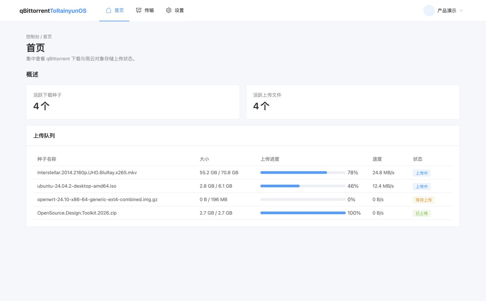
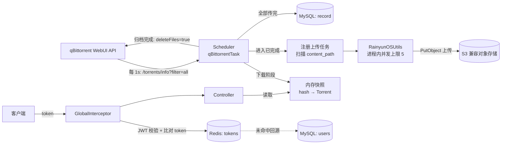

# qBittorrentToRainyunOS

轮询 qBittorrent 的种子状态，把**下载完成**的种子自动上传到 S3 协议兼容的对象存储（Rainyun / MinIO / AWS S3），
并提供下载进度、上传进度、传输记录三类查询接口。鉴权 token 缓存于 Redis，任务状态与进度保存在内存。

> 本仓库是**后端 API 服务**，前端为独立项目，未包含在内。

## 界面预览



## 解决什么问题

用 qBittorrent 挂机下载的场景里，常见流程是「下完 → 手动找文件 → 上传网盘 → 删本地」。
这个服务把这段全自动化：种子下完的那一刻就被识别出来，文件扫描后上传到对象存储，
进度可查、历史可查，归档完成后由 qBittorrent 一并删除种子与本地文件。

## 功能

- **状态轮询**：约每秒从 qBittorrent WebUI API 拉取全部种子，按 state 归类为下载中 / 已完成 / 异常
- **自动归档**：种子进入「已完成」后扫描 `content_path` 下的文件，逐个提交到 S3（当前为单次 `PutObject`，见「已知问题」）
- **进度上报**：文件级「已传字节 / 总字节 / 百分比 / 平均速度」，种子级汇总进度与总速度
- **失败重试**：单个文件上传失败标记为失败态，下一轮自动重试；种子级带汇总进度与总速度
- **异常任务跳过**：目录为空直接清理；文件读取失败（权限、掉盘、路径不可读）保留任务并在下一轮重试，不会误删数据
- **清理托管**：归档完成后调用 qBittorrent 的 `deleteFiles=true` 删除种子与文件，服务本身不做破坏性文件操作
- **传输记录**：归档完成后写入 MySQL，提供历史查询（按完成时间倒序，暂不分页）
- **鉴权与单端登录**：JWT（HS256）+ 服务端 token 比对。登录时 token 同时写入 MySQL 与 Redis
  （hash `tokens`，field 为用户 id，TTL 6 小时）；拦截器先查 Redis，未命中再回源 MySQL 并回填。
  新登录会覆盖旧 token，实现单端登录

## 技术栈

| 层 | 选型 |
|---|---|
| 语言 / 运行时 | Java 25 |
| 框架 | Spring Boot 4.0.7（Web MVC + Scheduling） |
| 持久层 | mybatis-spring-boot-starter 4.0.1（MyBatis 3.5.19）+ MySQL 8（connector-j 9.7） |
| 缓存 | Spring Data Redis（Lettuce），`RedisTemplate<String,String>`，仅缓存登录 token（需 Redis ≥ 8.0） |
| 对象存储 | AWS SDK for Java v2（`s3` + `s3-transfer-manager`），客户端与 TransferManager 由 `S3Config` 以单例 Bean 管理 |
| HTTP 客户端 | Apache HttpClient 5（调用 qBittorrent API） |
| JSON | Gson |
| 认证 | jjwt 0.13（HS256） |
| 测试 | JUnit Jupiter 6（6.0.3）+ `spring-test`（`ReflectionTestUtils`、`MockHttpServletRequest`），不起 Spring 上下文 |
| 其他 | Lombok、Logback（按天滚动 + gzip 归档） |

> `S3AsyncClient` 的 region 固定 `CN_NORTH_1`，并开启 `pathStyleAccessEnabled(true)`（MinIO 必需）。
> S3 兼容服务一般只把 region 当作签名的一部分，不影响实际寻址；接真实 AWS 时除了改 region，
> 还要把 `S3_ENDPOINT` 指向 AWS 端点，并按需关闭 path-style。

## 架构



目录结构：

```
Main/src/main/java/cn/zqat/qbittorrenttorainyunos
├── controller       # /login /overview /download /upload /record
├── service          # 接口 + 实现（UserServiceImpl 含 Redis token 缓存与回源）
├── schedule         # qBittorrentTask：轮询与状态机
├── utils            # qBittorrentUtils / RainyunOSUtils / JWTUtils / SizeUtils
├── interceptor      # 全局鉴权（JWT + Redis/MySQL token 比对）
├── config           # S3Config / RedisConfig / 拦截器注册 / @ConfigurationProperties
├── mapper           # MyBatis Mapper（注解 + XML）
├── pojo             # 实体与 DTO
└── exception        # 全局异常处理
```

## 快速开始

开始前需要：JDK 25、Maven 3.9+、MySQL 8、Redis 8.0+、qBittorrent 4.x / 5.x（WebUI 已开启）。
以下命令默认从仓库根目录执行（每个代码块独立）。

### 1. 建库建表

```sql
CREATE DATABASE IF NOT EXISTS qbt2s3 DEFAULT CHARSET utf8mb4;
USE qbt2s3;

CREATE TABLE users (
    id       INT PRIMARY KEY AUTO_INCREMENT,
    username VARCHAR(64)  NOT NULL UNIQUE,
    password CHAR(32)     NOT NULL COMMENT 'MD5（见 Roadmap）',
    email    VARCHAR(128),
    token    VARCHAR(512) COMMENT '当前有效 token，用于单端登录',
    avatar   VARCHAR(512)
);

CREATE TABLE record (
    id          BIGINT PRIMARY KEY AUTO_INCREMENT,
    name        VARCHAR(255) NOT NULL,
    size        BIGINT,
    update_time DATETIME
);

-- 初始账号：password 列存的是明文密码的 MD5（项目没有注册接口，必须先插一条）
-- 下面这条对应明文 admin123，可自己生成：printf 'admin123' | md5sum
INSERT INTO users (username, password, email, avatar)
VALUES ('admin', '0192023a7bbd73250516f069df18b500', NULL, NULL);
```

### 2. 准备 Redis

登录与鉴权依赖 Redis，先起一个（本地或容器都行）：

```bash
redis-server --daemonize yes
# 或
docker run -d --name qbt-redis -p 6379:6379 redis:8

redis-cli ping   # 期望 PONG
```

> 版本要求 **Redis ≥ 8.0**：`getAndExpire` / `putAndExpire` 底层是 `HGETEX` / `HSETEX`，
> 这两个命令从 Redis 8.0 才提供（7.4 只有 `HEXPIRE` 等字段过期命令），7.x 及更早版本会直接报
> `ERR unknown command 'HGETEX'`。装的是老版本就改成 `opsForHash().get()` + `redisTemplate.expire()` 两步。

Redis 配置前缀从 Spring Boot 3 起是 `spring.data.redis`，写成 `spring.redis` **不报错也不警告**，
只会被静默忽略、客户端永远连 `127.0.0.1:6379`。

### 3. 配置

所有配置项都支持环境变量覆盖，默认值指向本机（MySQL `127.0.0.1:3306`、Redis `127.0.0.1:6379`、qBittorrent `127.0.0.1:8080`）。

**但首次启动必须先配置 S3 凭据**：`S3Config` 里的 `S3AsyncClient` 是上下文初始化时就创建的单例 Bean，
密钥为空会直接启动失败：

```
BeanCreationException: Error creating bean with name 's3AsyncClient'
Factory method 's3AsyncClient' threw exception with message: Access key ID cannot be blank.
```

**数据库与 Redis 的行为相反**：Spring Boot 用无参构造 + setter 建 `HikariDataSource`，启动时不建立任何连接；
`RedisTemplate` 也是懒连接。所以 MySQL / Redis 都没起来时应用照样能启动，第一次查询（登录、写 record、鉴权）才失败。
`hikari.connection-timeout: 5000` 是等待**上限**——端口拒绝会立刻报错，网络不通才会等满 5 秒。
这也正是配这个值的原因：避免调度线程卡在连库上。

真实凭据请放在 `Main/src/main/resources/application-local.yaml`（相对仓库根目录；已在 `.gitignore` 中）。
注意：Spring Boot 只在对应 profile 激活时才加载 `application-{profile}.yaml`，所以启动时要带上 profile：

```bash
cd Main
mvn spring-boot:run -Dspring-boot.run.profiles=local
# 或
java -jar target/qBittorrentToRainyunOS-1.1.1.jar --spring.profiles.active=local
```

| 环境变量 | 默认值 | 说明 |
|---|---|---|
| `SERVER_PORT` | `8081` | 服务端口（避开 qBittorrent 默认的 8080） |
| `DB_URL` | `jdbc:mysql://127.0.0.1:3306/qbt2s3?...` | MySQL 连接串 |
| `DB_USERNAME` / `DB_PASSWORD` | `root` / `root` | 数据库账号 |
| `DB_POOL_SIZE` | `5` | Hikari 最大连接数 |
| `REDIS_HOST` / `REDIS_PORT` | `127.0.0.1` / `6379` | Redis 地址 |
| `REDIS_PASSWORD` | 空 | 无密码留空 |
| `REDIS_DB` | `0` | Redis 库号（token 缓存用的 hash `tokens`） |
| `S3_ENDPOINT` | `https://s3.example.com` | S3 兼容服务地址 |
| `S3_BUCKET` | `qbt-archive` | 目标桶 |
| `S3_ACCESS_KEY` / `S3_SECRET_KEY` | 空 | 存储密钥 |
| `QB_URL` | `http://127.0.0.1:8080` | qBittorrent WebUI 地址 |
| `QB_USERNAME` / `QB_PASSWORD` | `admin` / `adminadmin` | qBittorrent 账号 |
| `JWT_SECRET` | 内置开发密钥 | Base64，解码后 ≥ 32 字节 |
| `JWT_EXPIRATION_MS` | `604800000` | token 有效期（默认 7 天） |

### 4. 启动

```bash
cd Main
mvn spring-boot:run
# 或
mvn -DskipTests package && java -jar target/qBittorrentToRainyunOS-1.1.1.jar
```

启动后 API 监听在 `http://127.0.0.1:8081`（没有内置首页，前端为独立项目）。

> 前端与 API 不同源时，需要在开发服务器里代理 `/login`、`/overview` 等路径，或给后端加 CORS 配置；
> 当前项目没有 CORS 配置。

## 接口

统一响应体：

```json
{ "code": 1, "msg": "success", "data": {} }
```

`code = 1` 成功，`code = 0` 业务失败（`msg` 为原因）。

`/overview` 返回示例（`uploadList` 中的元素与 `/upload` 相同）：

```json
{
  "code": 1,
  "msg": "success",
  "data": {
    "torrentCount": 2,
    "uploadCount": 1,
    "uploadList": [
      { "hash": "...", "name": "Show", "status": 5, "progressPercent": 42, "upspeed": 1048576 }
    ]
  }
}
```

`/download` 返回全部 `Torrent`，字段见 `pojo/Torrent`；`files` 为文件级进度。

| 方法 | 路径 | 鉴权 | 说明 |
|---|---|---|---|
| POST | `/login` | 否 | 用户名密码换取 token |
| GET | `/overview` | 是 | 活跃下载数、活跃上传数、上传及上传失败列表 |
| GET | `/download` | 是 | 内存中的全部种子条目（含上传阶段；`status` 为 0–5 / 7 / 8，`6` 完成后立即移除） |
| GET | `/upload` | 是 | 正在上传及上传失败的种子 |
| GET | `/record` | 是 | 历史传输记录（`update_time` 倒序） |

鉴权方式：请求头 `token: <jwt>`，未通过返回 `401`（响应体为空，不走统一响应体）。

登录示例：

```bash
TOKEN=$(curl -s -X POST http://127.0.0.1:8081/login \
  -H 'Content-Type: application/json' \
  -d '{"username":"admin","password":"***"}' | jq -r .data.token)

curl -s http://127.0.0.1:8081/overview -H "token: $TOKEN"
```

### 状态码约定

下载阶段（`Torrent.status`）：

| 值 | 含义 | 对应 qBittorrent state |
|---|---|---|
| 0 | 未知 / 其它 | 未映射的状态 |
| 1 | 等待 / 暂停下载 | `stalledDL` `queuedDL`（4.x 还有 `pausedDL`） |
| 2 | 下载中 | `downloading` `forcedDL` |
| 3 | 已完成（做种中） | `uploading` `stalledUP` `forcedUP` `queuedUP` `checkingUP` `stoppedUP` |
| 7 | 下载失败 | `error` `missingFiles` `unknown` |

> qBittorrent 5.0+ 把 `pausedDL` / `pausedUP` 改名为 `stoppedDL` / `stoppedUP`。
> 当前映射保留了 4.x 的 `pausedDL` 和 5.x 的 `stoppedUP`，但 `stoppedDL` 与 4.x 的 `pausedUP` 未单独列出，会落到 `0`。
> `metaDL`（磁力链接元数据未就绪）也会落到 `0`，不属于文件读取失败；等元数据到位、状态变成下载中后会进入后续流程。

上传阶段（`Torrent.status`）：`4` 待上传 / `5` 上传中 / `6` 已完成（已写入 record） / `8` 上传失败（下一轮重试）。
文件级（`MyFile.status`）：`4` 等待 / `5` 上传中 / `6` 完成 / `8` 上传失败（下一轮重试）。

> `/download` 与 `/upload` 读的是同一份内存快照：`/download` 返回全部条目，`/upload` 只筛 `5` / `8`。
> 因此 `/download` 的返回里也会出现 `4` / `5` / `8`，前端按 `status` 分组即可。

状态流转：

```
下载 0/1/2 ──进入做种──▶ 注册 3 ──扫描完成──▶ 待传 4 ──提交──▶ 上传中 5 ──全部完成──▶ 6 落库 + 删除种子与文件
                                                    │
                                                    ├──有文件失败──▶ 8 ──下一轮重试──▶ 5
                                                    └──其他文件仍待传──▶ 4
```

## 测试

```bash
cd Main
mvn test
```

5 个测试类 / 15 个测试方法（参数化展开后 21 次执行），全部是纯 JUnit，不起 Spring 上下文、不连 MySQL / Redis / S3，可离线跑：

| 测试类 | 覆盖点 |
|---|---|
| `qBittorrentTaskTest` | S3 key 前缀：目录型种子 / 单文件种子 / 路径不存在 / 路径末尾带分隔符 |
| `TorrentServiceImplTest` | 活跃下载数、活跃上传数、`/upload` 只筛 `5`/`8` |
| `GlobalInterceptorTest` | 缺 token / 非法 token / 被顶掉的旧 token / 有效 token 四个分支 |
| `JWTUtilsTest` | 签发与解析 claim、过期 token、畸形 token |
| `SizeUtilsTest` | 字节数格式化到 KB / MB / GB / TB |

## 设计要点与踩过的坑

**1. 为什么不再用 `filter=completed`？**
早期用 `filter=completed`，读 qBittorrent 源码发现 `TorrentFilter` 的 `Completed` 分支调用 `torrent->isCompleted()`，
后者覆盖 6 个状态——`Uploading` / `StalledUploading` / `CheckingUploading` / `StoppedUploading` / `QueuedUploading` / `ForcedUploading`。
手写映射时少写任何一个（比如 `queuedUP`），种子就不会出现在返回列表里，永远停在「已下载但不上传」。
现在改用 `filter=all` + 显式状态映射，漏映射最多显示为 `0`，不会从列表里消失。

**2. qBittorrent 5.0 把 `pausedUP` 改名成 `stoppedUP`**
4.x 与 5.x 的 WebUI API state 字符串不一致。对比 4.5.5 / 4.6.2 / 5.0.0 三个 tag 的 `serialize_torrent.cpp` 确认后，
当前代码用显式枚举同时保留 `stalledUP` / `forcedUP` / `queuedUP` / `checkingUP` / `stoppedUP`；
4.x 的 `pausedUP` 还没补，见「状态码约定」的说明。更稳妥的写法是 `uploading` 或 `endsWith("UP")`，可一并覆盖 `pausedUP`。

**3. 每秒全量刷新会覆盖上传任务的状态**
最初把所有种子放在同一个 `Map<hash, Torrent>` 里，每秒用 API 返回的新对象整体覆盖。
结果上传中的任务被覆盖回「已完成待上传」，导致每秒重新扫描目录、重新提交上传、进度永远归零。
改成：下载阶段才覆盖快照；进入上传阶段后，任务对象只注册一次，状态单向流转。

**4. 判断「是否已开始上传」要用区间，不要等于某个中间态**
早期写成 `if (now.getStatus() == 3)`，而 `now` 可能是上一轮的下载快照（status 0/1/2），条件恒不成立，
种子下完永远不上传。改成 `status < 4`（还没进上传阶段）之后，下载 → 完成的状态迁移才真正打通。

**5. 破坏性操作交给产生数据的服务**
早期是服务自己 `Files.deleteIfExists` 遍历删除，空目录、权限不足、路径不存在都会各自出错，还得自己维护重试队列。
现在只调 `torrents/delete?deleteFiles=true`，让 qBittorrent 按它自己的 `content_path` 删——
删除范围由数据源定义，服务不再持有「要删哪些路径」这份状态。

**6. 「空」和「读失败」必须能区分**
目录为空是正常结束（清理种子即可）；文件读取失败是故障（保留任务、下一轮重试）。
两者混在一起时，默认值兜底会把故障伪装成正常跳过，导致文件被删而上传从未发生。

**7. 为什么不改成长轮询 / WebSocket？**
数据源（qBittorrent WebUI API）本身没有推送能力，只能轮询；1s 的间隔对单机场景足够，
真正的优化方向是 `sync/maindata` 的 `rid` 增量同步（见 Roadmap）。

**8. 缓存 TTL 和 JWT 有效期是两回事**
JWT 默认 7 天有效；Redis 里只缓存 6 小时（`Expiration.from(6, TimeUnit.HOURS)`，用 `getAndExpire` 读时续期）。
缓存过期不是登出——拦截器未命中会回源 `users.token` 并重新回填。真正的失效只有一种：新登录覆盖了 `users.token`。

**9. `getAndExpire` 读时续期，`putAndExpire` 写时设 TTL**
Spring Data Redis 4 的 hash 命令可以一条命令「读 + 续期」/「写 + 设 TTL」，
不用先 `opsForHash().get()` 再 `expire()` 两步（两步之间进程挂掉就会留下永不过期的 key）。

## 已知问题

**1. S3 key 固定平铺种子内的目录**
目录型种子的 key 前缀取 `content_path` 的目录名（`Show/01.mp4`），种子内部的子目录不保留
（`Show/Season 1/01.mp4` 仍上传为 `Show/01.mp4`），所以不同子目录里的同名文件会互相覆盖。
单文件种子（`content_path` 是文件）前缀为空，文件直接落在桶根目录；`content_path` 不存在时会在
`Files.walk` 阶段抛 `NoSuchFileException`，任务保留并下一轮重试，不会上传。
修复方向：改用「文件相对 `content_path` 的路径」生成 key，并做成可配置策略（保持子目录 / 平铺）。

**2. 任务状态只存在内存**
`hashTorrents` 是 `ConcurrentHashMap`，进程重启后全部丢失：已在传的文件要从头开始，已完成的种子会被重新识别。
Redis 目前只缓存登录 token，不承担任务状态。
修复方向：状态落库 + 启动恢复 + 利用分片上传的 `uploadId` 做断点续传（需先解决 #4 的 multipart 问题）。

**3. 失败重试没有退避**
文件上传失败后下一轮（约 1s）立即重试，持续失败时会以每秒一次的频率重试。
修复方向：指数退避 + 最大重试次数，超过阈值转人工处理。

**4. 上传没有走 multipart（分片）**

`S3TransferManager.uploadFile` 默认走单次 `PutObject`：实测 10 MB 与 128 MB 的文件都只发出一次
`PUT /{bucket}/{key}`，没有 `CreateMultipartUpload`。原因是 `S3AsyncClient` 构建时没有开启
`multipartEnabled(true)`——`GenericS3TransferManager` 内部用 `isS3ClientMultipartEnabled` 判断是否分片。

影响：单次 `PutObject` 上限 5 GB；失败要整文件重传；也无法用 `uploadId` 做断点续传。
修复方向：`S3AsyncClient.builder().multipartEnabled(true)`（可再配 `multipartConfiguration` 调分片阈值），
或改用 CRT 客户端。

**5. 单实例设计**
上传并发上限（5）是 `RainyunOSUtils` 里的进程内 `AtomicInteger`，不是 TransferManager 的配置；
任务状态也在内存。多实例部署时各实例独立维护 `hashTorrents` 和并发计数（Redis 里的 token 缓存是共享的），
同一个种子可能被多个实例重复上传。
修复方向：状态与并发控制外置（Redis 分布式锁 / 数据库抢占）。

**6. Redis 是鉴权的硬依赖，没有降级**
Redis 不可用时 `/login`（成功路径）和所有带鉴权的接口都会抛 `RedisConnectionFailureException`（应用本身能启动）。
而且登录流程是「先 `users.token` 落库、再写 Redis」，Redis 抛异常时 MySQL 里的 token 已经换成新的，
客户端却没拿到；此时 Redis 里可能还是旧 token，鉴权先读 Redis，会出现 MySQL / Redis 不一致，
旧 token 在一段时间内仍可能通过鉴权。
修复方向：读写 Redis 包一层 try-catch，失败时直接走 MySQL；或加本地兜底缓存。

**7. 异常响应没有统一状态码**
`GlobalExceptionHandle` 只返回 `Result.err(msg)`，没有设 HTTP 状态码，所以业务异常和 5xx 都会是 **HTTP 200 + `code: 0`**。
（`401` 是拦截器显式设的状态码，这个是准的。）前端只能靠 `code` 判断，需要约定清楚。

## Roadmap

- [ ] **启用 multipart 上传**：`multipartEnabled(true)`，为大文件分片与断点续传打底
- [ ] **状态持久化**：上传任务状态落库（`upload_task` 表），重启后恢复并支持断点续传
- [ ] **降低轮询开销**：连接池复用 + cookie 缓存 + `sync/maindata?rid` 增量同步
- [ ] **失败退避**：指数退避 + 最大重试次数
- [ ] **鉴权缓存降级**：Redis 不可用时回源 MySQL / 本地缓存
- [ ] **统一异常状态码**：业务异常 4xx/5xx 与 `code` 对应
- [ ] **密码存储**：MD5 → BCrypt
- [ ] **S3 key 策略可配置**：保持子目录结构 / 平铺
- [ ] **传输记录分页**
- [x] **单元测试**（5 类 / 15 个方法，21 次执行，`mvn test`）
- [ ] **集成测试**：起 Spring 上下文 + 容器化 MySQL / Redis / MinIO 跑通整条归档链路

### 后续功能扩展

- 通过 API 添加任务：提交磁力链 / 种子文件，调用 qBittorrent 添加下载
- RSS 订阅：解析 RSS 源，按规则自动添加种子

## License

[MIT](LICENSE) © 2026 zhuiqiuat
