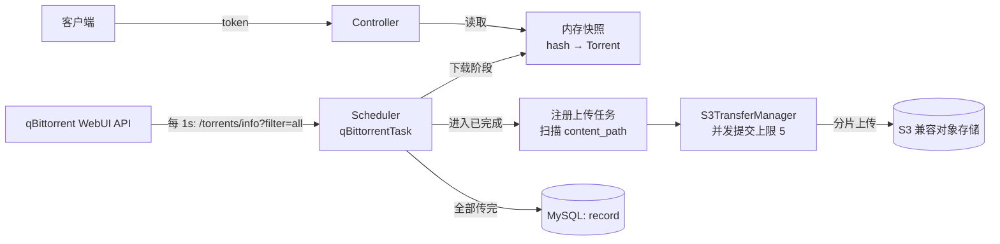

# qBittorrentToRainyunOS

轮询 qBittorrent 的种子状态，把**下载完成**的种子自动分片上传到 S3 协议兼容的对象存储（Rainyun / MinIO / AWS S3），
并提供下载进度、上传进度、传输记录三类查询接口。

> 本仓库是**后端 API 服务**，前端为独立项目，未包含在内。

## 解决什么问题

用 qBittorrent 挂机下载的场景里，常见流程是「下完 → 手动找文件 → 上传网盘 → 删本地」。
这个服务把这段全自动化：种子下完的那一刻就被识别出来，文件扫描后上传到对象存储，
进度可查、历史可查，完成后清理本地文件并从 qBittorrent 移除任务。

## 功能

- **状态轮询**：每秒从 qBittorrent WebUI API 拉取全部种子，按 state 归类为下载中 / 已完成 / 异常
- **自动归档**：种子进入「已完成」后扫描 `content_path` 下的文件，逐个提交到 S3（`S3TransferManager` 负责分片与重试）
- **进度上报**：文件级「已传字节 / 总字节 / 百分比 / 实时速度」，种子级汇总进度与总速度
- **传输记录**：归档完成后写入 MySQL，提供历史查询
- **鉴权**：JWT + 库内 token 比对，实现单端登录（新登录会顶掉旧会话）
- **快速失败**：Hikari 连接超时 5s，避免定时任务线程被数据库拖死

## 技术栈

| 层 | 选型 |
|---|---|
| 语言 / 运行时 | Java 25 |
| 框架 | Spring Boot 4.0.7（Web MVC + Scheduling） |
| 持久层 | MyBatis 4.0.1 + MySQL 8 |
| 对象存储 | AWS SDK for Java v2（`s3` + `s3-transfer-manager`） |
| HTTP 客户端 | Apache HttpClient 5（调用 qBittorrent API） |
| JSON | Gson |
| 认证 | jjwt 0.13（HS256） |
| 其他 | Lombok、Logback（按天滚动 + gzip 归档） |

## 架构



目录结构：

```
Main/src/main/java/cn/zqat/qbittorrenttorainyunos
├── controller       # /login /overview /download /upload /record
├── service          # 接口 + 实现
├── schedule         # qBittorrentTask：轮询与状态机
├── utils            # qBittorrentUtils / RainyunOSUtils / JWTUtils / SizeUtils
├── interceptor      # 全局鉴权
├── config           # 拦截器注册 / @ConfigurationProperties
├── mapper           # MyBatis Mapper（注解 + XML）
├── pojo             # 实体与 DTO
└── exception        # 全局异常处理
```

## 快速开始

### 1. 建库建表

```sql
CREATE DATABASE IF NOT EXISTS qbt2s3 DEFAULT CHARSET utf8mb4;
USE qbt2s3;

CREATE TABLE users (
    id       INT PRIMARY KEY AUTO_INCREMENT,
    username VARCHAR(64)  NOT NULL UNIQUE,
    password CHAR(32)     NOT NULL COMMENT 'MD5（见 Roadmap）',
    email    VARCHAR(128),
    token    VARCHAR(512) COMMENT '当前有效 token，用于单端登录',
    avatar   VARCHAR(512)
);

CREATE TABLE record (
    id          BIGINT PRIMARY KEY AUTO_INCREMENT,
    name        VARCHAR(255) NOT NULL,
    size        BIGINT,
    update_time DATETIME
);
```

### 2. 配置

所有配置项都支持环境变量覆盖，本地不设置也能用默认值启动（默认指向 `127.0.0.1`）。
真实凭据请放在 `application-local.yaml`（已在 `.gitignore` 中）。

| 环境变量 | 默认值 | 说明 |
|---|---|---|
| `SERVER_PORT` | `8081` | 服务端口（避开 qBittorrent 默认的 8080） |
| `DB_URL` | `jdbc:mysql://127.0.0.1:3306/qbt2s3?...` | MySQL 连接串 |
| `DB_USERNAME` / `DB_PASSWORD` | `root` / `root` | 数据库账号 |
| `S3_ENDPOINT` | `https://s3.example.com` | S3 兼容服务地址 |
| `S3_BUCKET` | `qbt-archive` | 目标桶 |
| `S3_ACCESS_KEY` / `S3_SECRET_KEY` | 空 | 存储密钥 |
| `QB_URL` | `http://127.0.0.1:8080` | qBittorrent WebUI 地址 |
| `QB_USERNAME` / `QB_PASSWORD` | `admin` / `adminadmin` | qBittorrent 账号 |
| `JWT_SECRET` | 内置开发密钥 | Base64，解码后 ≥ 32 字节 |
| `JWT_EXPIRATION_MS` | `604800000` | token 有效期（默认 7 天） |

### 3. 启动

```bash
cd Main
mvn spring-boot:run
# 或
mvn -DskipTests package && java -jar target/qBittorrentToRainyunOS-1.1.0.jar
```

启动后访问 `http://127.0.0.1:8081`。

## 接口

统一响应体：

```json
{ "code": 1, "msg": "success", "data": {} }
```

`code = 1` 成功，`code = 0` 业务失败（`msg` 为原因）。

| 方法 | 路径 | 鉴权 | 说明 |
|---|---|---|---|
| POST | `/login` | 否 | 用户名密码换取 token |
| GET | `/overview` | 是 | 活跃下载数、活跃上传数、上传列表 |
| GET | `/download` | 是 | 全部种子及下载状态 |
| GET | `/upload` | 是 | 正在上传的种子 |
| GET | `/record` | 是 | 历史传输记录 |

鉴权方式：请求头 `token: <jwt>`，未通过返回 `401`。

登录示例：

```bash
TOKEN=$(curl -s -X POST http://127.0.0.1:8081/login \
  -H 'Content-Type: application/json' \
  -d '{"username":"admin","password":"***"}' | jq -r .data.token)

curl -s http://127.0.0.1:8081/overview -H "token: $TOKEN"
```

### 状态码约定

下载阶段（`Torrent.status`）：

| 值 | 含义 | 对应 qBittorrent state |
|---|---|---|
| 0 | 未知 / 其它 | 未映射的状态 |
| 1 | 等待、暂停 | `stalledDL` `pausedDL` `queuedDL` |
| 2 | 下载中 | `downloading` `forcedDL` |
| 3 | 已完成（做种中） | `uploading` `stalledUP` `forcedUP` `queuedUP` `checkingUP` `stoppedUP` |
| 7 | 异常 | `error` `missingFiles` `unknown` |

上传阶段（`Torrent.status`）：`4` 待上传 / `5` 上传中 / `6` 已完成（已写入 record）。
文件级（`MyFile.status`）：`4` 等待 / `5` 上传中 / `6` 完成 / `7` 失败（下一轮重试）。

## 设计要点与踩过的坑

**1. `filter=completed` 到底包含哪些状态？**
读 qBittorrent 源码得到答案：`TorrentFilter` 的 `Completed` 分支调用 `torrent->isCompleted()`，
后者覆盖 6 个状态——`Uploading` / `StalledUploading` / `CheckingUploading` / `StoppedUploading` / `QueuedUploading` / `ForcedUploading`。
手写映射时少写任何一个（比如 `queuedUP`），种子就会永远停在「已下载但不上传」。

**2. qBittorrent 5.0 把 `pausedUP` 改名成 `stoppedUP`**
4.x 与 5.x 的 WebUI API state 字符串不一致。对比 4.5.5 / 4.6.2 / 5.0.0 三个 tag 的 `serialize_torrent.cpp` 确认后，
用「`uploading` 或以 `UP` 结尾」来判断做种状态，一套逻辑同时兼容两个大版本。

**3. 每秒全量刷新会覆盖上传任务的状态**
最初把所有种子放在同一个 `Map<hash, Torrent>` 里，每秒用 API 返回的新对象整体覆盖。
结果上传中的任务被覆盖回「已完成待上传」，导致每秒重新扫描目录、重新提交上传、进度永远归零。
改成：下载阶段才覆盖快照；进入上传阶段后，任务对象只注册一次，状态单向流转。

**4. 判断「是否已开始上传」要用区间，不要等于某个中间态**
早期写成 `if (now.getStatus() == 3)`，而 `now` 可能是上一轮的下载快照（status 0/1/2），条件恒不成立，
种子下完永远不上传。改成 `status < 4`（还没进上传阶段）之后，下载 → 完成的状态迁移才真正打通。

**5. 为什么不改成长轮询 / WebSocket？**
数据源（qBittorrent WebUI API）本身没有推送能力，只能轮询；1s 的间隔对单机场景足够，
真正的优化方向是 `sync/maindata` 的 `rid` 增量同步（见 Roadmap）。

## 已知问题

**1. S3 key 只保留了种子根目录名**
当前实现取 `content_path` 的第三段作为前缀，多级子目录会被平铺到同一个前缀下，
不同子目录里的同名文件在桶里会互相覆盖。修复方向：改用「文件相对 `content_path` 的路径」生成 key，
并做成可配置策略（保持子目录 / 平铺）。

**2. 任务状态只存在内存**
`hashTorrents` 是 `ConcurrentHashMap`，进程重启后全部丢失：已在传的文件要从头开始，已完成的种子会被重新识别。
修复方向：状态落库 + 启动恢复 + 利用分片上传的 `uploadId` 做断点续传。

**3. 并发上传上限是近似值**
用 `int cnt` 计数实现「同时最多 5 个文件」，在多个上传回调线程里自增自减不是原子的，
实际并发可能超过上限。修复方向：换成 `Semaphore`。

## Roadmap

- [ ] **状态持久化**：上传任务状态落库（`upload_task` 表），重启后恢复并支持断点续传
- [ ] **降低轮询开销**：连接池复用 + cookie 缓存 + `sync/maindata?rid` 增量同步
- [ ] **密码存储**：MD5 → BCrypt
- [ ] **并发控制**：`Semaphore` 替代计数器，保证并发上限严格生效
- [ ] **S3 key 策略可配置**：保持子目录结构 / 平铺
- [ ] **传输记录分页**
- [ ] **单元测试与集成测试**（当前为空）

### 后续功能扩展

- 通过 API 添加任务：提交磁力链 / 种子文件，调用 qBittorrent 添加下载
- RSS 订阅：解析 RSS 源，按规则自动添加种子

## License

MIT
